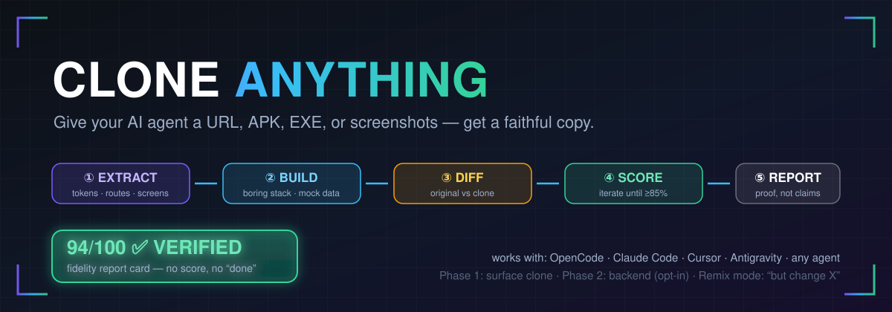
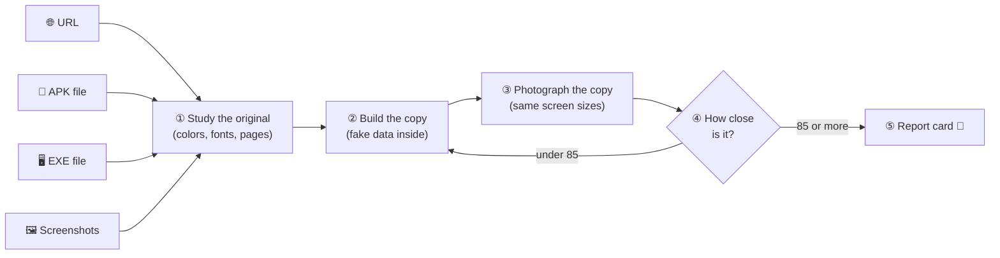
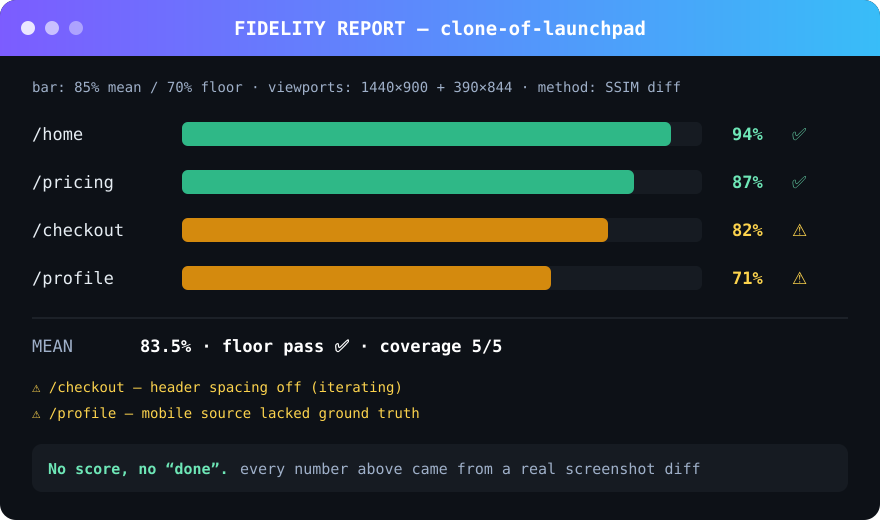
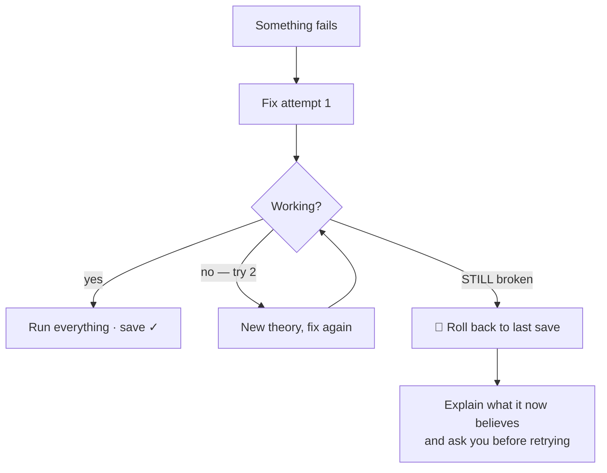

[](LICENSE)
[](INSTALL.md)
[](examples/FIDELITY.md)
[](https://github.com/kingenious0/clone-anything/stargazers)

<h1 align="center">🧬 Clone Anything</h1>

<p align="center"><b>Give your AI agent a website or app — it builds you a copy,<br>then <i>proves</i> the copy matches the original with a scored report card.</b></p>

<p align="center">
  
</p>

<p align="center">Works with <b>OpenCode · Claude Code · Cursor · Antigravity</b> — any agent that reads Markdown.</p>

---

## 😵 The problem

You say *"clone this website"* to an AI. It builds… **something**. Then it says:

> *"Done! It's perfect!"*

…without ever checking. Sometimes it's actually perfect. Sometimes the font is wrong, two pages are missing, and the colors are off. **You have no way to know.**

## ✅ The one rule

> **No score, no "done."**

The agent must take pictures of the real site and its copy, **compare them side by side**, and hand you a report card with actual numbers. Claims are free — scores aren't.

## 🎬 How it works



The loop keeps going — fixing the worst pages first — until most pages score **85/100 or better**. Then you get:

<p align="center"></p>

**Three phases:**

| Phase | What happens | When |
|-------|-------------|------|
| **0 — Study** | Look at the original, write a one-page plan (max 5 pages in v1) | Always |
| **1 — Copy & check** | The loop above → report card | Always |
| **2 — Make it real** | Swap the fake data for a real database, logins, APIs | **Only if you ask** |

## 🧰 What can you copy from?

| You give it… | It reads… | How good is that? |
|---|---|---|
| 🌐 **Website link** | Every page's colors, fonts, buttons, layout | ⭐⭐⭐ High |
| 📱 **Android app** (.apk) | The app's *real* color list, text, and screen list | ⭐⭐⭐ High |
| 🖥️ **Computer program** (.exe) | If it's the common kind — the **actual code inside** | ⭐⭐⭐ Highest |
| 🖥️ **EXE** (other kinds) | Icons, text, any web links it contains | ⭐⭐ Medium |
| 🖼️ **Screenshots** | Colors, fonts, and layout read from the images | ⭐⭐ Medium |
| 🎥 **Screen recording** | Pages *and* how they move | ⭐⭐ Medium |
| ✏️ **Just a name** ("clone Airbnb") | Searches the web for what it looks like, then starts | ⭐⭐ Medium |

**Combine them** (APK + screenshots + store page) and it gets even closer — more clues = better copy.

## 🍳 Recipes — just say one of these

**1️⃣ Clone a landing page**
> *"Clone this site: https://example.com"*

Studies it → builds it → scores every page → report card. Works even while you watch.

**2️⃣ Clone a mobile app from its APK**
> *"Here's the APK for <app> — build me a web version"*

The APK contains the app's real colors and screen list, so the copy starts from truth, not guesses.

**3️⃣ Copy it, but rebrand it**
> *"Clone stripe.com, but make it green and call it Finlytics"*

First: an **exact copy**, saved. *Then* your changes, each saved as its own step — undo any single one and the original look comes right back.

**4️⃣ Rescue a dying build** *(works on any project, clone or not)*
> *"(mid-project) It keeps breaking" / "where were we?"*

The built-in rescue habits kick in — see below.

## 🛟 Why the build never falls apart

Every clone (and any project using this skill) follows four habits:

- 🧪 **Tests before "done"** — every claim comes with the command output that proves it
- 📸 **A save point every time something works** — one bad edit can never ruin your project; one command brings back the last working version
- 📝 **A "where were we" note** — tomorrow's session reads it and picks up in under a minute
- 🧠 **It knows when to stop** — same failure 3 times in a row? Instead of guessing, it rolls back to the last save and *asks you first*:



## 🤥 Honest limitations (no lying allowed)

- **The look gets copied** (pages, buttons, colors) — with **fake sample data** inside, like a movie set: looks real, nothing behind the walls
- **The brain can't be read from a link** — a real database/logins/payments is Phase 2, only if you say so
- **Don't ship someone else's logo or brand name** — neutral placeholders are used by default to keep you out of trouble
- **No score, no "done"** — if the agent can't take screenshots, it says so and uses the closest check instead of pretending

## 📦 Install

**→ Full instructions for every agent: [INSTALL.md](INSTALL.md)**

Quick version:

| Your AI assistant | Put `SKILL.md` here |
|---|---|
| **OpenCode** | `~/.config/opencode/skills/clone-anything/` |
| **Claude Code** | `~/.claude/skills/clone-anything/` |
| **Cursor** | `.cursor/rules/clone-anything.md` |
| **Antigravity / Codex** | your `AGENTS.md` |
| **Copilot** | `.github/copilot-instructions.md` |
| **Windsurf** | `.windsurfrules` |

Not listed? If your AI can read a file you point it at — it works.

## 👀 See it on paper

Real filled-in examples of everything the skill produces:

- [`examples/CLONE-SPEC.md`](examples/CLONE-SPEC.md) — the one-page plan
- [`examples/FIDELITY.md`](examples/FIDELITY.md) — the report card
- [`examples/COVERAGE.md`](examples/COVERAGE.md) — every page: done or visibly deferred
- [`examples/PROGRESS.md`](examples/PROGRESS.md) — the "where were we" note

## 📁 What you end up with

```
your-project/
├── CLONE-SPEC.md     ← the one-page plan
├── PLAN.md           ← the to-do list
├── PROGRESS.md       ← the "where were we" note
├── COVERAGE.md       ← which pages are done / not done
├── tokens.json       ← the colors & fonts we found
├── original/         ← pictures of the real thing
├── clone/            ← your copy
└── FIDELITY.md       ← the report card
```

## ⚖️ Responsible use

Clone Anything is for **learning, prototyping, and reskinning what you have rights to** — not for passing a copy off as someone else's site or shipping their logo/brand as your own. The skill already swaps brand assets for neutral placeholders by default. Full details in **[DISCLAIMER.md](DISCLAIMER.md)** — read it before publishing anything public.

## 🤝 Contributing

Found it failing on a site? Have an agent we don't cover? Ideas to make the loop tighter? **[Open an issue](https://github.com/kingenious0/clone-anything/issues)** or send a PR — see **[CONTRIBUTING.md](CONTRIBUTING.md)** for the rules of the house (kid-friendly README, agent-precise SKILL.md, and: *no score, no "done"* — even in PRs).

## 📄 License

[MIT](LICENSE) — copy it, fork it, remix it. That's the whole point. 🧬
